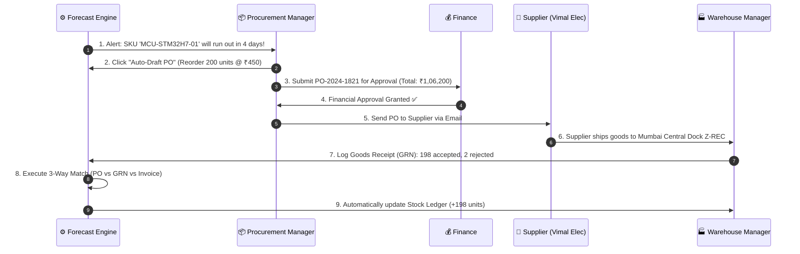

# 📘 NEXUS — Complete & Simple Guide

Welcome to **NEXUS**! This document explains **what this project is**, **what every module does**, and **how all the pieces work together in a simple, easy-to-understand way**.

---

## 💡 1. What is NEXUS? (The Big Picture)

Imagine a large manufacturing or trading company (like an electronics maker or car manufacturer). They have:
- Thousands of components (microchips, batteries, packaging boxes, cables).
- Multiple large warehouses in different cities (Mumbai, Bengaluru, Delhi, Chennai, Hyderabad).
- Dozens of suppliers who sell them parts.

**NEXUS is the "Brain" and Control Center for this entire operations chain.**

Without NEXUS, a company might run out of microchips without knowing, halting an entire factory line. Or they might over-buy parts they don't need and waste millions of rupees.

NEXUS continuously monitors stock levels, predicts when items will run out, automatically drafts purchase orders to suppliers, tracks shipments when they arrive at warehouses, and keeps an exact financial record.

---

## 🔑 2. Key Terms Explained Simply

Before looking at the modules, here are 5 simple terms used throughout the application:

| Term | What it Means | Real-World Example |
|---|---|---|
| **SKU** *(Stock Keeping Unit)* | A unique code for a specific product. | `MCU-STM32H7-01` = ARM Microcontroller chip |
| **PO** *(Purchase Order)* | An official contract sent to a supplier to buy items. | "Dear Vimal Electronics, please send us 200 microcontrollers for ₹1,06,200." |
| **GRN** *(Goods Receipt Note)* | A record created by warehouse staff when items actually arrive at the receiving dock. | "Box received today. 198 items good, 2 damaged." |
| **3-Way Match** | An automatic check comparing: **PO** vs **GRN (Delivered)** vs **Invoice (Bill)** before finance pays. | Ensures the company only pays for what was ordered AND actually delivered. |
| **Stock Ledger** | A permanent transaction bank statement for physical inventory. | "+200 received on 12-Oct", "-50 used for factory on 15-Oct". |

---

## 🧩 3. Detailed Breakdown of All 11 Modules

Here is what every page in NEXUS does, explained step-by-step:

---

### 1. 🎛️ Command Center (Dashboard)
- **What it is**: The main control screen when you log in.
- **What it does**: Gives a real-time health overview of the whole business.
- **Key Features**:
  - **Morning Intelligence Brief**: Highlights urgent tasks (e.g. "2 items will run out this week").
  - **Live KPI Counters**: Total inventory value (in ₹), stockout risks, pending PO approvals, and active alerts.
  - **Quick Action Bar**: Buttons to quickly jump into creating POs or adjusting stock.

---

### 2. 📦 Inventory & Stock Ledger
- **What it is**: The catalog of all products (SKUs) and their exact counts across all warehouses.
- **What it does**: Tracks where every single item is kept and in what quantity.
- **Key Features**:
  - **Stock Levels**: Shows quantity on hand, allocated quantity (reserved), and quantity on order.
  - **Stock Adjustment**: Allows warehouse managers to adjust counts if items are damaged or found during audit.
  - **Stock Transfer**: Move items from Mumbai warehouse to Bengaluru warehouse.
  - **Ledger History**: An immutable log showing every single movement in and out.

---

### 3. 🛒 Procurement & Purchase Orders
- **What it is**: The buying center.
- **What it does**: Handles buying new stock from suppliers when inventory gets low.
- **Key Features**:
  - **PO Creation**: Select a supplier, choose products, enter quantities, and generate an official PO.
  - **PO Lifecycle**: Tracks PO stages (`Draft` ➔ `Submitted` ➔ `Approved` ➔ `Sent to Supplier` ➔ `Partially Received` ➔ `Received` ➔ `Cancelled`).
  - **GRN Processing**: Log items received at the warehouse dock and perform 3-Way Match validation.

---

### 4. 🤝 Suppliers (Vendor Directory)
- **What it is**: The company address book and performance tracker for all suppliers.
- **What it does**: Manages supplier relationships, contact details, payment terms, and delivery performance.
- **Key Features**:
  - **Supplier Profiles**: Store GSTIN tax numbers, emails, phone numbers, and payment terms (e.g., `Net 30`).
  - **Reliability Rating**: 5-star rating calculated from past delivery punctuality and quality.
  - **Lead Time Tracking**: How many days it takes for each supplier to deliver orders.

---

### 5. 🏭 Warehouse Management
- **What it is**: The digital twin of physical warehouses.
- **What it does**: Manages physical spaces, pallet capacity, and bin locations.
- **Key Features**:
  - **Logistics Hubs**: Mumbai Central, Bengaluru Tech Hub, Delhi-NCR, Chennai Port, Hyderabad.
  - **Occupancy Tracking**: Shows how full each warehouse is (e.g., 3,850 / 5,000 pallets used).
  - **Bin & Aisle Location**: Maps products to specific locations like `AISLE-2-BAY-4`.

---

### 6. 📈 Forecast Lab (Intelligence Engine)
- **What it is**: The AI & mathematical prediction room.
- **What it does**: Predicts future demand and tells you **when you will run out of stock**.
- **Key Features**:
  - **Runway (Days of Supply)**: E.g., "At current usage, Microcontrollers will run out in **4.2 days**."
  - **Automated Reorder Engine**: Automatically calculates the exact quantity needed to order before stock runs out.
  - **1-Click Auto-Draft PO**: Press one button to turn a forecast recommendation into a ready-to-send Purchase Order.

---

### 7. 🎛️ What-If Simulator
- **What it is**: A risk-testing playground.
- **What it does**: Allows managers to simulate "what-if" emergency scenarios before they happen.
- **Key Features**:
  - **Scenario 1 (Supplier Delay)**: "What happens to our production if Supplier Vimal is delayed by 14 days?"
  - **Scenario 2 (Demand Spike)**: "What happens if customer demand suddenly increases by +40%?"
  - **Impact Analysis**: Shows exact stockout dates and financial loss risks in real time.

---

### 8. 🔔 Operational Alerts & Anomalies
- **What it is**: The warning system.
- **What it does**: Detects operational problems automatically and alerts the team.
- **Key Features**:
  - **Stockout Warnings**: Alerts when stock falls below safety levels.
  - **Overdue PO Alerts**: Flags purchase orders that haven't arrived on the promised delivery date.
  - **Acknowledge & Resolve**: Managers can mark alerts as acknowledged or resolved after taking action.

---

### 9. 💰 Cost Analytics & Savings
- **What it is**: The financial intelligence dashboard.
- **What it does**: Analyzes where money is being spent and highlights opportunities to save costs.
- **Key Features**:
  - **Holding Cost Analysis**: Money tied up in unused inventory sitting in warehouses.
  - **Supplier Price Variance**: Compares prices between different suppliers for the same item.
  - **GST Breakdown**: Tracks GST input tax credits and taxes paid.

---

### 10. 📋 Reports & Audit Logs
- **What it is**: The compliance & record-keeping vault.
- **What it does**: Generates formal business reports and maintains a security log of every single action taken in the system.
- **Key Features**:
  - **Exportable Reports**: Inventory Valuation Report, Supplier Performance Summary, PO Register (Excel/CSV/PDF).
  - **Append-Only Audit Log**: A tamper-proof history recording *who did what, when, from which IP address* (e.g., "Rajesh approved PO-2024-1821 at 10:45 AM").

---

### 11. ⚙️ Settings & User Roles (RBAC)
- **What it is**: The administration panel.
- **What it does**: Manages organization details and user access permissions.
- **Key Features**:
  - **5 Role Permissions**:
    1. 👑 **Admin**: Full control over everything.
    2. 📦 **Procurement Manager**: Manages SKUs, suppliers, and purchase orders.
    3. 🏭 **Warehouse Manager**: Manages stock counts, adjustments, and receipts at the docks.
    4. 💰 **Finance**: Approves POs financially, validates invoices, and inspects costs.
    5. 📋 **Auditor**: Read-only compliance access + exclusive audit logs.

---

## 🔄 4. The Complete Real-World Workflow (End-to-End Story)

Here is a step-by-step example of how NEXUS handles a real-world supply chain event:

### Step-by-Step Explanation of the Story:
1. **Forecast Engine detects low stock**: The system notices Microchip stock in Mumbai is down to 2 units and projects a stockout in 4 days.
2. **Auto-Draft PO**: The Procurement Manager opens the Forecast Lab and clicks **"Auto-Draft PO"**. NEXUS fills out the supplier, item quantity, and price.
3. **Approval Request**: The PO goes to Finance for approval because it exceeds ₹1,00,000.
4. **Approval**: Finance reviews budget and approves the PO.
5. **Sent to Supplier**: The PO status changes to `SENT` and is transmitted to Vimal Electronics.
6. **Delivery at Warehouse**: 3 days later, a delivery truck arrives at Mumbai Central Warehouse.
7. **GRN & Inspection**: The Warehouse Manager inspects the shipment, finds 198 good chips and 2 damaged chips, and submits a Goods Receipt Note (GRN).
8. **3-Way Match**: NEXUS matches the GRN (198 items) with the PO (200 ordered) and Supplier Invoice.
9. **Ledger & Inventory Updated**: NEXUS adds +198 units to the Mumbai stock level, creates an immutable Stock Ledger entry, and resolves the stockout alert!

---

## 🎯 5. Quick Summary

| If you want to... | Go to this page in NEXUS... |
|---|---|
| See business health at a glance | **Command Center** (`/app`) |
| Check how many microchips or boxes are in stock | **Inventory** (`/app/inventory`) |
| Order more items from a vendor | **Procurement** (`/app/procurement`) |
| Look up vendor contact details or rating | **Suppliers** (`/app/suppliers`) |
| Check warehouse capacity in Mumbai | **Warehouse** (`/app/warehouse`) |
| See when items will run out | **Forecast Lab** (`/app/forecasting`) |
| Test what happens if deliveries are delayed | **Simulator** (`/app/simulator`) |
| View urgent warnings and stockout alerts | **Alerts** (`/app/alerts`) |
| See financial spend & tax breakdown | **Cost & Savings** (`/app/cost`) |
| Export data or inspect audit trails | **Reports** (`/app/reports`) |
| Switch accounts or change organization details | **Settings / Header Switcher** |

---

*Document created for NEXUS Platform.*
